# GitDiagram architecture — @konitif/compliance

This architecture view was generated from the public repository by [GitDiagram](https://gitdiagram.com/lemouf/konitif-compliance) on 2026-09-20 18:43:17 UTC.

It is a documentation projection of the repository tree, README, and source files sampled by GitDiagram. It does not replace the authored contracts in [catalog.json](catalog.json) and [diagrams.json](diagrams.json), nor does it establish runtime authority.

The Mermaid source keeps GitDiagram's groups, nodes, relationships, and source links. GitDiagram's forced color classes and HTML line breaks are omitted so the diagram remains readable in local previews and dark themes.

- Public repository: [konitif-compliance](https://github.com/LeMouf/konitif-compliance)
- Interactive diagram: [Open in GitDiagram](https://gitdiagram.com/lemouf/konitif-compliance)

## Architecture diagram

```mermaid
flowchart TD

subgraph group_public["Public Contracts"]
  node_api["Public API — [index.ts]"]
  node_schema["Assessment Schemas — [schema.ts]"]
end

subgraph group_collection["Evidence Collection"]
  node_collector_runner["Collector Runner — [collectorRunner.ts]"]
  node_evidence["Evidence Factory — [evidence.ts]"]
end

subgraph group_assessment["Compliance Assessment"]
  node_policy["Policy Evaluation — [policy.ts]"]
  node_guidance["Guidance Builder — [guidance.ts]"]
end

subgraph group_outputs["Reports And Purity"]
  node_snapshots["Snapshot Comparison — [snapshots.ts]"]
  node_render["Report Rendering — [render.ts]"]
  node_purity["Purity Analysis — [purity.ts]"]
end

node_caller(("Assessment Caller"))

node_caller -->|"calls API"| node_api
node_api -->|"re-exports"| node_schema
node_api -->|"re-exports"| node_collector_runner
node_api -->|"re-exports"| node_evidence
node_api -->|"re-exports"| node_policy
node_api -->|"re-exports"| node_guidance
node_api -->|"re-exports"| node_snapshots
node_api -->|"re-exports"| node_render
node_api -->|"re-exports"| node_purity
node_collector_runner -->|"uses contracts"| node_schema
node_collector_runner -->|"creates timeout evidence"| node_evidence
node_collector_runner -->|"returns results"| node_caller
node_caller -->|"submits results"| node_policy
node_policy -->|"uses dimensions"| node_schema
node_policy -->|"sorts evidence"| node_evidence
node_policy -->|"returns report"| node_caller
node_caller -->|"requests guidance"| node_guidance
node_guidance -->|"uses contracts"| node_schema
node_guidance -->|"returns guidance"| node_caller
node_caller -->|"compares reports"| node_snapshots
node_snapshots -->|"uses contracts"| node_schema
node_snapshots -->|"returns comparison"| node_caller
node_caller -->|"renders report"| node_render
node_render -->|"uses report types"| node_schema
node_render -->|"returns output"| node_caller
node_caller -->|"runs purity analysis"| node_purity
node_purity -->|"returns purity report"| node_caller

click node_api "https://github.com/lemouf/konitif-compliance/blob/main/src/index.ts"
click node_schema "https://github.com/lemouf/konitif-compliance/blob/main/src/schema.ts"
click node_collector_runner "https://github.com/lemouf/konitif-compliance/blob/main/src/collectorRunner.ts"
click node_evidence "https://github.com/lemouf/konitif-compliance/blob/main/src/evidence.ts"
click node_policy "https://github.com/lemouf/konitif-compliance/blob/main/src/policy.ts"
click node_guidance "https://github.com/lemouf/konitif-compliance/blob/main/src/guidance.ts"
click node_snapshots "https://github.com/lemouf/konitif-compliance/blob/main/src/snapshots.ts"
click node_render "https://github.com/lemouf/konitif-compliance/blob/main/src/render.ts"
click node_purity "https://github.com/lemouf/konitif-compliance/blob/main/src/purity.ts"

```

## Generated analysis

@konitif/compliance is a deterministic assessment library. A caller supplies product context and collector implementations, runs collection, then passes results to report evaluation. Evidence is normalized and aggregated into dimension and global statuses, after which callers can derive guidance, create or compare snapshots, and render reports. A parallel purity model assesses repository authorities and findings. The sampled source confirms these runtime paths; caller-owned collectors and policy profiles are intentionally outside the package.
